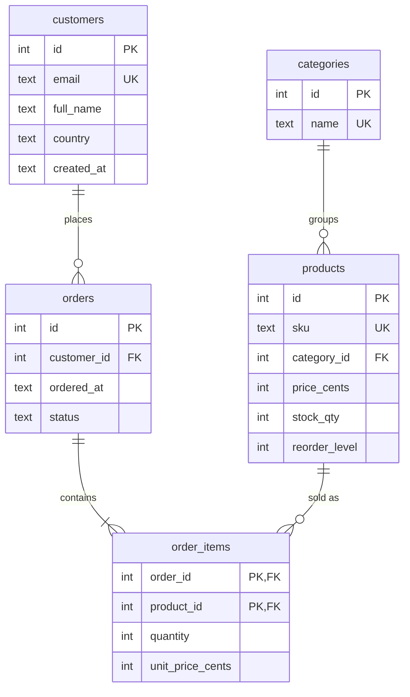

# E-commerce Analytics in SQL

[](https://github.com/Nexude-ZainaV/sql-ecommerce-analytics/actions/workflows/ci.yml)


A normalised store schema, a hand-checkable dataset, and ten business reports written
in SQL: running totals, month-over-month growth, top-N per group, customer lifetime
value, cohort retention, reorder planning and more. Every report is covered by a
snapshot test, and invariant tests check that the numbers add up.

## Schema



- Money is stored as **integer cents**; reports divide by 100.0 only for display.
- `order_items.unit_price_cents` is copied at purchase time, so a price change never
  rewrites order history.
- `CHECK`, `UNIQUE` and foreign-key constraints reject bad data at the database, and
  indexes cover every foreign key and the date filters.
- Two views, `v_sales_lines` and `v_order_totals`, define "revenue" once (paid, shipped
  or delivered orders) so every report agrees on it.

## Reports

| # | Report | SQL techniques |
|---|---|---|
| 01 | [Monthly revenue + year-to-date](queries/01_monthly_revenue_running_total.sql) | `GROUP BY`, window `SUM() OVER (ORDER BY)` |
| 02 | [Month-over-month growth](queries/02_month_over_month_growth.sql) | CTE, `LAG()`, `NULLIF` |
| 03 | [Top 2 products per category](queries/03_top_products_per_category.sql) | `ROW_NUMBER() OVER (PARTITION BY)` |
| 04 | [Customer lifetime value](queries/04_customer_lifetime_value.sql) | `LEFT JOIN`, `COALESCE`, `DENSE_RANK()`, percent of total |
| 05 | [Repeat vs one-time buyers](queries/05_repeat_customer_rate.sql) | `CASE` bucketing, scalar subquery |
| 06 | [Products never sold](queries/06_products_never_sold.sql) | anti-join with `NOT EXISTS` |
| 07 | [Order value vs store average](queries/07_order_value_vs_average.sql) | `HAVING`, aggregate vs overall average |
| 08 | [Cohort retention](queries/08_cohort_retention.sql) | `MIN() OVER (PARTITION BY)`, month arithmetic, pivot with `COUNT(DISTINCT CASE)` |
| 09 | [Reorder report](queries/09_reorder_report.sql) | parameter CTE, date modifiers, urgency `CASE` |
| 10 | [Cancellation rate by category](queries/10_cancellation_rate_by_category.sql) | conditional aggregation |

Sample output (report 08):

```
cohort  | cohort_size | month_1 | month_2 | month_3_plus
--------+-------------+---------+---------+-------------
2026-01 | 3           | 1       | 2       | 3
2026-02 | 2           | 0       | 1       | 0
2026-03 | 2           | 0       | 2       | 0
```

Expected output for every report is in [tests/expected/](tests/expected/).

## Run it

Python 3.12+ (standard library only):

```bash
python reports.py              # build an in-memory database and print every report
python reports.py 04 08        # only reports 04 and 08
python reports.py --db store.db  # also save the database to explore in DB Browser, DBeaver or VS Code
```

Or with the `sqlite3` command-line shell:

```bash
sqlite3 store.db < sql/01_schema.sql
sqlite3 store.db < sql/02_seed.sql
sqlite3 store.db < sql/03_views.sql
sqlite3 -header -column store.db < queries/04_customer_lifetime_value.sql
```

Tests:

```bash
python -m unittest discover -s tests -v
```

## Porting to PostgreSQL or MySQL

The window functions, CTEs and joins are standard SQL. The SQLite-specific parts are
date handling: `strftime('%Y-%m', d)` becomes `to_char(d, 'YYYY-MM')` (PostgreSQL) or
`DATE_FORMAT(d, '%Y-%m')` (MySQL), and `date(x, '-90 days')` becomes
`x - INTERVAL '90 days'`. Dates are stored as ISO 8601 text here; a server database
would use a native `DATE` column.

## License

[MIT](LICENSE)
